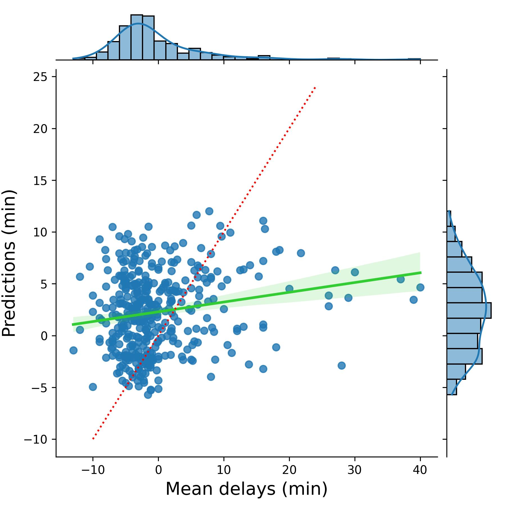

# Airline Departure Delay ML Pipeline

A reproducible machine-learning workflow for predicting departure delays for flights leaving **John F. Kennedy International Airport (JFK)**. The project uses Python and scikit-learn for data preparation and Ridge regression, **MLflow** for experiment tracking, and **DVC** for data version control.

This project was completed for D602 – Deployment in the M.S. Data Analytics - Data Engineering program at Western Governors University.

## Project Overview

The workflow turns raw flight records into a model-ready dataset and evaluates a regression model for departure-delay prediction. The pipeline:

1. Imports the raw flight dataset and keeps the fields required for modeling.
2. Renames fields to a consistent schema and writes an intermediate dataset.
3. Filters the data to JFK departures and removes incomplete or invalid records.
4. Converts scheduled flight times and prepares destination-airport features.
5. One-hot encodes destination airports and creates training, validation, and test data.
6. Trains Ridge regression models across multiple alpha values.
7. Tracks model parameters and metrics with MLflow.
8. Evaluates the model on held-out test data and exports model artifacts.

## Technologies

- Python 3.12
- pandas
- NumPy
- scikit-learn
- MLflow
- DVC (Data Version Control)
- Matplotlib
- Seaborn
- Conda

## Dataset Processing

The import stage processed **539,747 flight records**. After filtering to JFK departures and removing incomplete or invalid records, **8,164 records** remained for the modeling workflow.

## Model

The modeling script uses Ridge regression with destination-airport one-hot encoding and scheduled departure/arrival time features. The first three weeks of the month's data are used for model development, while later-month records are held out for testing.

MLflow records the Ridge penalty values, training metrics, final test metrics, and selected artifacts so experiments can be compared and reproduced.

### Recorded final run

- **Test Mean Squared Error (MSE):** 79.17
- **Test RMSE / average prediction error:** approximately 8.90 minutes

> Results can vary between runs because the training/validation split is randomized in the original implementation.

## Model Performance

## Running the Pipeline

The project defines MLflow entry points in `MLproject`. After placing the source dataset at `data/raw/flight_data.csv` and creating the project environment, the complete workflow can be launched with:

**mlflow run .**

The pipeline can also be executed directly:

**python main.py**

The individual stages are available through the MLflow project entry points for importing data, cleaning data, and training the model.

## Data Versioning

DVC was used during development to track the intermediate trimmed dataset. The `.dvc` metadata file is included while the large CSV itself is excluded from GitHub.

## Attribution

The regression modeling script is based in substantial part on Fabien Daniel's *Predicting Flight Delays Tutorial* on Kaggle. The project adapts that foundation to model flights from a single departure airport across destinations and incorporates a broader pipeline including data import and cleaning, MLflow experiment tracking, DVC-based data versioning, test evaluation, logging, and artifact export.

The original attribution is also preserved in the source code.

## Skills Demonstrated

Python • Machine Learning • Data Cleaning • Data Pipelines • Ridge Regression • scikit-learn • MLflow • MLOps • Data Version Control (DVC) • Model Evaluation • Reproducible Workflows

## Author

**Tomeka Pena**  
M.S. Data Analytics – Data Engineering  
Western Governors University
